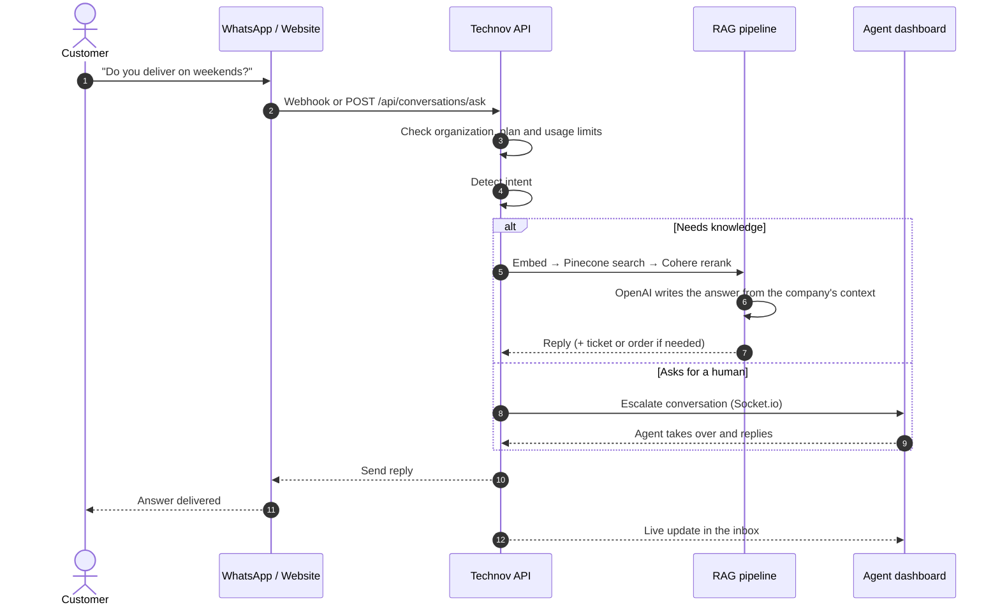
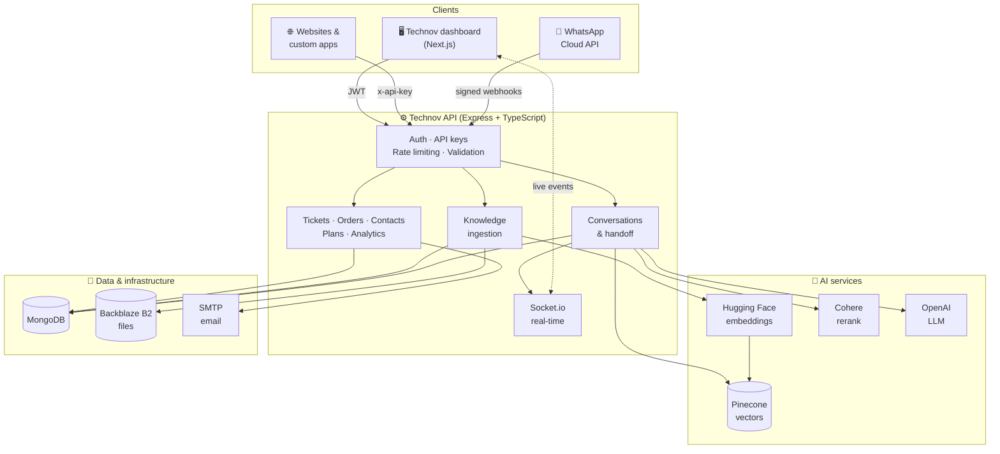

<div align="center">

# 🤖 Technov

### Your AI support agent, trained on your business, working 24/7.

Technov is a multi-tenant SaaS platform that gives every business its own AI customer support agent.<br/>
It answers customers on **WhatsApp** and the **web** using only that company's knowledge,<br/>
and hands the conversation to a human agent the moment it's needed.

<br/>


[](LICENSE)

[](https://github.com/Eng-Mohamed-abdirahman/technov/actions/workflows/ci.yml)


**[Features](#-key-features)** · **[How it works](#-how-it-works)** · **[Architecture](#-architecture)** · **[Quick start](#-quick-start)** · **[API](#-using-the-api)** · **[Deployment](#-deployment)**

</div>

---

## 📑 Table of contents

- [About the project](#-about-the-project)
- [Key features](#-key-features)
- [How it works](#-how-it-works)
- [Architecture](#-architecture)
- [Tech stack](#-tech-stack)
- [Repository structure](#-repository-structure)
- [Quick start](#-quick-start)
- [Testing and quality checks](#-testing-and-quality-checks)
- [Using the API](#-using-the-api)
- [Roles and permissions](#-roles-and-permissions)
- [Subscription plans](#-subscription-plans)
- [Security](#-security)
- [Deployment](#-deployment)
- [Roadmap](#-roadmap)
- [Contributing](#-contributing)
- [License](#-license)
- [Author](#-author)

---

## 💡 About the project

Small and medium businesses get the same questions every day: *What are your prices? Are you open on Friday? Where is my order?* Answering them takes hours, and customers who message at night wait until morning.

**Technov solves this with an AI agent that knows the business.** A company uploads its documents, connects its WhatsApp number or website, and the agent starts answering straight away. It's grounded in the company's own data, not generic internet knowledge.

- ✅ **Accurate:** answers come only from the company's knowledge base (retrieval-augmented generation).
- ✅ **Always on:** replies in seconds, day and night.
- ✅ **Human when it matters:** customers can ask for a person, and agents take over the live chat in one click.
- ✅ **Built for many businesses:** every organization's data, keys, usage and settings are fully isolated.

---

## ✨ Key features

<table>
<tr>
<td width="50%" valign="top">

### 🧠 AI that knows your business
- Upload **PDF** and **DOCX** documents as the knowledge base
- Text is chunked, embedded and indexed in **Pinecone**
- Results are **reranked with Cohere** before the AI answers
- **Intent detection** handles greetings, thanks and handoff requests without spending tokens
- **Knowledge insights** reveal what customers ask that your docs don't cover

</td>
<td width="50%" valign="top">

### 💬 Omnichannel conversations
- **WhatsApp Business** via Meta Embedded Signup
- Website and custom apps via a secure **REST API**
- One **live inbox** for every channel
- Real-time updates over **Socket.io**
- Signed webhook verification for WhatsApp

</td>
</tr>
<tr>
<td width="50%" valign="top">

### 🙋 Human handoff
- AI escalates when it can't help or the customer asks for a person
- Agents **take over** a chat and reply live
- **Return to AI** with one click when done
- **Tickets** keep the full conversation history

</td>
<td width="50%" valign="top">

### 🏢 Built for SaaS
- **Multi-tenant** organizations with isolated data
- Email **invitations** for companies and staff
- **API keys**: create, reveal, rotate, revoke
- **Subscription plans** with limits, feature flags and an audit log
- **Usage tracking** of tokens and requests per organization

</td>
</tr>
<tr>
<td width="50%" valign="top">

### 📊 Analytics dashboards
- Separate dashboards for **platform admins**, **company admins** and **staff**
- Conversation trends, AI resolution rate, peak hours
- Channel mix, ticket status and staff performance

</td>
<td width="50%" valign="top">

### 🛒 Business tools
- AI can create **orders** and **tickets** from the chat
- **Contacts** book, searchable by phone number
- **AI design studio** for posters, flyers and social posts in your brand colors *(in progress)*

</td>
</tr>
</table>

---

## ⚙️ How it works

### For a business: live in 4 steps

| Step | What happens |
| :---: | --- |
| **1. Get invited** | The platform admin invites the company by email. The owner completes onboarding and receives an API key. |
| **2. Train the AI** | Upload FAQs, price lists, policies and company information to the knowledge base. |
| **3. Connect channels** | Connect a WhatsApp Business number in a few clicks, or call the API from a website. |
| **4. Go live** | The AI answers customers 24/7, and the team watches, takes over and analyses from the dashboard. |

### For a customer message: from question to answer



---

## 🏗 Architecture



---

## 🧰 Tech stack

| Layer | Technologies |
| --- | --- |
| **Frontend** | Next.js 16 (App Router), React 19, TypeScript, Tailwind CSS 4, shadcn/ui, Radix UI, TanStack Query, React Hook Form, Zod, Recharts, Framer Motion |
| **Backend** | Node.js, Express 5, TypeScript, Mongoose, Zod, Socket.io, Multer |
| **AI / ML** | OpenAI (`gpt-4o-mini` by default), Hugging Face Inference (embeddings), Pinecone (vector DB), Cohere (rerank), Replicate (image generation) |
| **Database** | MongoDB |
| **Integrations** | WhatsApp Cloud API (Meta Graph), Nodemailer (SMTP), Backblaze B2 (S3-compatible storage), Inngest (background jobs) |
| **Security** | JWT, bcrypt, AES-256-GCM key encryption, Helmet, express-rate-limit |

---

## 📁 Repository structure

This is a **monorepo** with two independent apps:

```text
technov/
├── backend/                 # REST API, AI pipeline, webhooks, Socket.io
│   ├── src/
│   │   ├── controllers/     # Request handlers
│   │   ├── services/        # Business logic (RAG, WhatsApp, plans, sockets...)
│   │   ├── models/          # Mongoose schemas
│   │   ├── routes/          # API routes
│   │   ├── middlewares/     # Auth, API keys, rate limits, uploads, signatures
│   │   └── validators/      # Zod request schemas
│   ├── docs/                # API and Postman guides
│   └── README.md            # ➜ Full backend documentation
│
├── frontend/                # Landing page + role-based dashboard
│   ├── app/                 # Next.js routes (marketing, login, dashboard)
│   ├── components/          # UI, dashboard, charts, landing sections
│   ├── services/            # Typed API clients
│   ├── hooks/  types/  lib/
│   └── README.md            # ➜ Full frontend documentation
│
├── LICENSE
└── README.md
```

| App | Docs | Default URL |
| --- | --- | --- |
| Backend | [backend/README.md](backend/README.md) | `http://localhost:5000` |
| Frontend | [frontend/README.md](frontend/README.md) | `http://localhost:3000` |

---

## 🚀 Quick start

### Option A: Docker (one command)

```bash
git clone https://github.com/Eng-Mohamed-abdirahman/technov.git
cd technov
cp backend/.env.example backend/.env   # add your AI keys here
docker compose up --build
```

This starts MongoDB, the API on `http://localhost:5000` and the dashboard on `http://localhost:3000`. Create the first admin:

```bash
docker compose exec -e SEED_USER_EMAIL=admin@example.com -e SEED_USER_PASSWORD=change-me backend node dist/scripts/seed-super-admin.js
```

### Option B: Run locally

### Prerequisites

| Tool | Version | Notes |
| --- | --- | --- |
| [Node.js](https://nodejs.org) | 22 LTS | Comes with npm |
| [MongoDB](https://www.mongodb.com) | 6+ | Local install or free MongoDB Atlas cluster |
| [OpenAI](https://platform.openai.com) API key | — | Needed for AI replies |
| Pinecone, Hugging Face, Cohere | — | Needed for the knowledge base (Cohere is optional) |

### 1. Clone the repository

```bash
git clone https://github.com/Eng-Mohamed-abdirahman/technov.git
cd technov
```

### 2. Set up the backend

```bash
cd backend
npm install
```

Copy the example environment file and fill in your keys. Only the **Core** section is needed to start the API; the AI keys are needed for replies:

```bash
cp .env.example .env
```

Create the first super admin, then start the API:

```bash
npm run seed:super-admin
npm run dev
```

### 3. Set up the frontend

In a **second terminal**:

```bash
cd frontend
npm install
cp .env.example .env.local
npm run dev
```

### 4. Open the app

Go to **[http://localhost:3000](http://localhost:3000)** and sign in with the super admin you seeded. From there you can invite a company, upload knowledge and start chatting.

> 📘 See [backend/README.md](backend/README.md#-environment-variables) for every environment variable, including WhatsApp, email, storage and the design studio.

---

## 🧪 Testing and quality checks

| Command | Where | What it checks |
| --- | --- | --- |
| `npm test` | `backend/` | API tests with Jest + Supertest against an in-memory MongoDB (no setup needed) |
| `npm run typecheck` | `backend/`, `frontend/` | TypeScript in strict mode |
| `npm run lint` | `frontend/` | ESLint (Next.js rules) |
| `npm run build` | `backend/`, `frontend/` | Production builds |

The backend tests cover authentication, **tenant isolation** (one company can never read or change another company's conversations), API-key handling (revoked keys, suspended organizations, multiple keys), the support handoff endpoints, CORS and security headers, and the AI intent detection and text chunking.

Every push and pull request runs all of these in **GitHub Actions** ([`.github/workflows/ci.yml`](.github/workflows/ci.yml)).

---

## 🔌 Using the API

Every organization gets an **API key** from the dashboard (**API Keys** page). Use it to connect any website or app to its AI agent.

```bash
curl -X POST http://localhost:5000/api/conversations/ask \
  -H "x-api-key: YOUR_ORGANIZATION_API_KEY" \
  -H "Content-Type: application/json" \
  -d '{
        "message": "What are your opening hours?",
        "customer": { "name": "Amina" }
      }'
```

Every response uses the same envelope:

```json
{
  "success": true,
  "message": "Conversation reply generated successfully",
  "data": {
    "reply": "We're open Saturday to Thursday, 8 AM to 10 PM.",
    "intent": "support_question",
    "conversationId": "665f1c...",
    "usage": { "totalTokens": 412, "monthlyLimit": 100000 }
  }
}
```

**Main endpoints**

| Endpoint | Auth | Description |
| --- | --- | --- |
| `POST /api/conversations/ask` | API key | Send a customer message and get the AI reply |
| `POST /api/tickets` | API key | Create a support ticket |
| `POST /api/auth/login` | — | Dashboard login (returns a JWT) |
| `POST /api/knowledge/upload` | JWT | Upload a knowledge document |
| `PUT /api/conversations/:id/takeover` | JWT | Agent takes over a conversation |
| `GET /api/dashboard/company` | JWT | Company analytics |
| `GET /api/health` | — | Health check |

The full endpoint list is in [backend/README.md](backend/README.md#-api-overview), with Postman guides in [`backend/docs/`](backend/docs).

---

## 👥 Roles and permissions

| Role | Who | Can do |
| --- | --- | --- |
| **Platform admin** | The Technov operator | Invite companies, manage all organizations, create and assign plans, view global usage |
| **Company admin** | Business owner or manager | Manage the knowledge base, WhatsApp, API keys, team, branding, usage and billing |
| **Staff** | Support agent | Handle the inbox, take over chats, manage tickets, orders and contacts |

The dashboard sidebar and every API route adapt to the signed-in user's role.

---

## 💳 Subscription plans

Platform admins create plans from the dashboard. Each plan controls:

- **Limits:** websites, WhatsApp numbers, team members, conversations per month and knowledge storage
- **Feature flags:** analytics, knowledge AI, conversation summaries, FAQ insights, sentiment analysis, API access, custom branding, white-label, advanced security, priority support and a dedicated manager
- **Pricing:** monthly and yearly

Every plan change is recorded in an **audit log**, and companies can request upgrades from their dashboard.

---

## 🔐 Security

- **Authentication:** JWT for the dashboard, per-organization API keys for integrations
- **Secrets at rest:** passwords hashed with bcrypt; API keys encrypted with AES-256-GCM
- **Tenant isolation:** every query is scoped to the caller's organization
- **Webhook integrity:** WhatsApp payloads verified with the `x-hub-signature-256` HMAC
- **Abuse protection:** rate limits on general API (300 / 15 min), login (10 / 15 min), AI (30 / min), uploads and webhooks
- **Hardening:** Helmet headers, Zod input validation, request IDs, strong secrets enforced in production

> Found a vulnerability? Please report it privately to the author instead of opening a public issue.

---

## 🚢 Deployment

| App | Recommended hosting | Notes |
| --- | --- | --- |
| **Frontend** | [Vercel](https://vercel.com) | Set the project root to `frontend/` and add `NEXT_PUBLIC_API_URL`. |
| **Backend** | Render, Railway, Fly.io, or any VPS | Root `backend/`, build with `npm run build`, start with `npm start`. |
| **Database** | MongoDB Atlas | Set `MONGO_URI`. |

**Production checklist**

- [ ] `NODE_ENV=production`
- [ ] `JWT_SECRET`, `INVITATION_JWT_SECRET` and `WHATSAPP_APP_SECRET` are each 32+ characters
- [ ] `PUBLIC_API_URL` points to your HTTPS backend URL
- [ ] WhatsApp webhook registered at `https://<your-api>/api/webhooks/whatsapp`
- [ ] `FRONTEND_URL` and `CORS_ORIGINS` include your frontend domain

---

## 🗺 Roadmap

- [x] Multi-tenant organizations, invitations and API keys
- [x] RAG knowledge base with reranking
- [x] WhatsApp Business integration
- [x] Real-time human handoff
- [x] Subscription plans and analytics dashboards
- [ ] Embeddable website chat widget
- [ ] AI design studio and brand identity (in progress)
- [ ] Orders management UI
- [x] Automated test suite and CI
- [x] Docker Compose for local development

---

## 🤝 Contributing

Contributions are welcome.

1. **Fork** the repository.
2. Create a branch: `git checkout -b feature/amazing-feature`.
3. Make your changes in `backend/` or `frontend/` and run the checks above.
4. Commit using [Conventional Commits](https://www.conventionalcommits.org): `git commit -m "feat(tickets): add ticket assignment"`.
5. Push and open a **pull request**. CI must pass before merging.

See [CONTRIBUTING.md](CONTRIBUTING.md) for the full guidelines.

Found a bug or have an idea? [Open an issue](https://github.com/Eng-Mohamed-abdirahman/technov/issues).

---

## 📄 License

Distributed under the **MIT License**. See [`LICENSE`](LICENSE) for details.

---

## 👨‍💻 Author

<table>
<tr>
<td>

**Mohamed Abdirahman**<br/>
[](https://github.com/Eng-Mohamed-abdirahman)

</td>
</tr>
</table>

<div align="center">

<br/>

**If Technov helps you, please give it a ⭐. It helps others find the project.**

</div>
