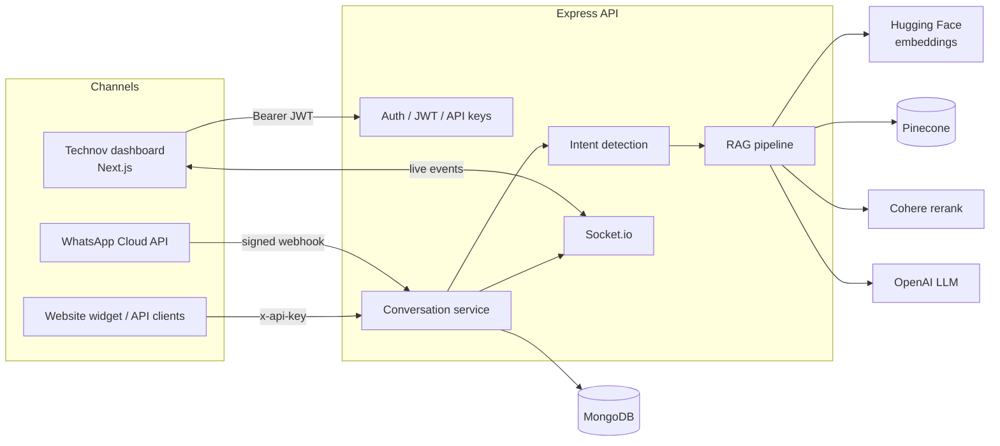

<div align="center">

# Technov — Customer Support Backend

**The API behind Technov, a multi-tenant SaaS that gives every business its own AI support agent, trained on its own knowledge and available 24/7 on WhatsApp and the web.**


[](../LICENSE)

[Features](#-features) · [Architecture](#-architecture) · [Getting started](#-getting-started) · [Environment](#-environment-variables) · [API](#-api-overview) · [Frontend](../frontend)

</div>

---

## 📖 Overview

Technov lets a company upload its documents (FAQs, price lists, policies, opening hours), connect its WhatsApp Business number or website, and get an AI assistant that answers customers using **only that company's knowledge**. When the AI can't help, or a customer asks for a person, the conversation is handed off to a human agent in real time.

This repository is the **backend**: a TypeScript + Express 5 API with MongoDB, a retrieval-augmented generation (RAG) pipeline, WhatsApp Cloud API integration, Socket.io for live chat, and an AI design studio.

> The dashboard UI lives in **[`frontend/`](../frontend)** in this repository.

## ✨ Features

| Area | What it does |
| --- | --- |
| 🏢 **Multi-tenancy** | Each organization has its own users, API keys, knowledge base, conversations and usage limits. |
| 🧠 **RAG knowledge base** | Upload PDF or DOCX files (up to 10 MB) → text is parsed, chunked, embedded (Hugging Face) and stored in Pinecone. Answers are retrieved, reranked with Cohere and generated with OpenAI. |
| 🎯 **Intent detection** | Greetings, thanks, small talk, order requests and "talk to a human" are recognized before the RAG pipeline, saving tokens and latency. |
| 💬 **WhatsApp Business** | Embedded Signup, signed webhook verification (`x-hub-signature-256`), inbound message handling and outbound replies via the Graph API. |
| 🙋 **Human handoff** | Agents can take over a conversation from the AI and hand it back. Messages stream live over Socket.io. |
| 🎫 **Tickets & orders** | The AI can create support tickets and orders on its own; staff manage their status from the dashboard. |
| 👥 **Contacts** | Customer contact book, searchable by phone number. |
| 📊 **Dashboards** | Separate analytics for the platform admin, company admins and staff, plus AI insights on knowledge-base gaps. |
| 💳 **Subscription plans** | Platform admins create plans, assign them to organizations and get a full audit log of plan changes. |
| ✉️ **Invitations** | Email invitations (Nodemailer) with signed, expiring tokens to onboard companies and staff. |
| 🎨 **AI design studio** | Generate posters, flyers, banners and social posts with Replicate, using the company's brand colors, fonts and logo. |
| 🔐 **Security** | JWT auth, hashed and encrypted API keys, role-based access, Helmet, rate limiting, request IDs and Zod validation. |

## 🏗 Architecture



**How a customer message is answered**

1. A message arrives from WhatsApp (webhook) or the website (`POST /api/conversations/ask` with an `x-api-key`).
2. The organization, its plan and its usage limits are checked.
3. **Intent detection** decides whether the message needs knowledge retrieval at all.
4. If it does, the question is embedded, the top matches are pulled from **Pinecone**, reranked by **Cohere**, and trimmed to a context budget.
5. **OpenAI** writes the reply from that context only, and can create tickets or orders as actions.
6. The reply is saved, sent back on the original channel, and pushed to the dashboard through **Socket.io**. If a human handoff is needed, the conversation is escalated to agents.

## 🧰 Tech stack

- **Runtime:** Node.js, TypeScript, Express 5
- **Database:** MongoDB with Mongoose
- **AI:** OpenAI (chat), Hugging Face Inference (embeddings), Pinecone (vector search), Cohere (rerank), Replicate (image generation)
- **Realtime:** Socket.io
- **Storage:** Backblaze B2 (S3-compatible) for logos and generated designs
- **Background jobs:** Inngest (design generation)
- **Messaging:** WhatsApp Cloud API, Nodemailer
- **Validation & security:** Zod, Helmet, express-rate-limit, bcryptjs, jsonwebtoken

## 🚀 Getting started

### Prerequisites

- **Node.js 18+** and npm
- **MongoDB** (local or MongoDB Atlas)
- API keys for the AI services you want to use: OpenAI, Hugging Face, Pinecone, Cohere (optional), Replicate (optional)
- For WhatsApp: a Meta developer app with the WhatsApp product enabled

### 1. Clone and install

```bash
git clone https://github.com/Eng-Mohamed-abdirahman/technov.git
cd technov/backend
npm install
```

### 2. Configure environment

Create a `.env` file in the project root. The minimum to boot locally:

```env
PORT=5000
MONGO_URI=mongodb://localhost:27017/support-saas
JWT_SECRET=change-me-to-a-long-random-string
FRONTEND_URL=http://localhost:3000
OPENAI_API_KEY=sk-...
```

See [Environment variables](#-environment-variables) for the full list.

### 3. Create the first super admin

```env
SEED_USER_EMAIL=admin@example.com
SEED_USER_PASSWORD=a-strong-password
```

```bash
npm run seed:super-admin
```

### 4. Run

```bash
npm run dev
```

The API is now on `http://localhost:5000`. Check it:

```bash
curl http://localhost:5000/api/health
```

### Scripts

| Command | Description |
| --- | --- |
| `npm run dev` | Start the API with hot reload (`ts-node-dev`). |
| `npm run build` | Compile TypeScript to `dist/`. |
| `npm start` | Run the compiled server from `dist/`. |
| `npm run seed:super-admin` | Create or update the first user from `SEED_USER_*` variables. |
| `npm run inngest` | Start the local design-job runner (default port `4001`). |

## 🔑 Environment variables

<details open>
<summary><b>Core</b></summary>

| Variable | Required | Default | Description |
| --- | --- | --- | --- |
| `PORT` | | `5000` | HTTP port. |
| `NODE_ENV` | | `development` | Set to `production` to enforce strong secrets. |
| `MONGO_URI` | ✅ | `mongodb://localhost:27017/support-saas` | MongoDB connection string. |
| `JWT_SECRET` | ✅ | — | Signing secret for access tokens (32+ chars in production). |
| `JWT_EXPIRES_IN` | | `7d` | Access-token lifetime. |
| `JWT_ISSUER` / `JWT_AUDIENCE` | | `supportly-api` / `supportly-web` | JWT claims. |
| `ENCRYPTION_KEY` | Recommended | derived from `JWT_SECRET` | AES-256 key for encrypting stored API keys (64 hex chars or any string). |
| `FRONTEND_URL` | ✅ | `http://localhost:3000` | Used in invitation links. |
| `PUBLIC_API_URL` | | `http://localhost:PORT` | Public URL of this API (webhooks). |
| `CORS_ORIGINS` | | — | Comma-separated list of allowed origins. |
| `ALLOW_PUBLIC_SIGNUP` | | `true` outside production | Allow open sign-up. |

</details>

<details>
<summary><b>AI services</b></summary>

| Variable | Default | Description |
| --- | --- | --- |
| `OPENAI_API_KEY` | — | Chat completions for support replies. |
| `OPENAI_LLM_MODEL` | `gpt-4o-mini` | Model used for replies. |
| `HF_TOKEN` | — | Hugging Face token for embeddings. |
| `HF_EMBEDDING_MODEL` | `google/embeddinggemma-300m` | Embedding model. |
| `HF_PROVIDER` | `hf-inference` | Inference provider. |
| `HF_LLM_MODEL` / `HF_LLM_PROVIDER` | `mistralai/Mistral-7B-Instruct-v0.3` | Optional Hugging Face LLM fallback. |
| `PINECONE_API_KEY` | — | Pinecone API key. |
| `PINECONE_INDEX_NAME` / `PINECONE_INDEX_HOST` | — | Pinecone index. |
| `COHERE_API_KEY` | — | Optional reranking. |
| `COHERE_RERANK_MODEL` | `rerank-english-v3.0` | Rerank model. |

</details>

<details>
<summary><b>WhatsApp</b></summary>

| Variable | Default | Description |
| --- | --- | --- |
| `WHATSAPP_APP_ID` | — | Meta app ID (required in production). |
| `WHATSAPP_APP_SECRET` | — | Meta app secret, used to verify webhook signatures. |
| `WHATSAPP_OAUTH_REDIRECT_URI` | — | Redirect URI for Embedded Signup. |
| `WHATSAPP_GRAPH_BASE_URL` | `https://graph.facebook.com` | Graph API base URL. |
| `WHATSAPP_GRAPH_VERSION` | `v20.0` | Graph API version. |
| `WHATSAPP_VERIFY_SIGNATURE` | `true` | Set `false` only for local testing. |
| `WEBHOOK_PUBLIC_URL` | — | Public HTTPS URL Meta sends webhooks to (e.g. an ngrok URL). |

</details>

<details>
<summary><b>Storage, email, invitations and design studio</b></summary>

| Variable | Description |
| --- | --- |
| `B2_ACCESS_KEY_ID`, `B2_SECRET_ACCESS_KEY` | Backblaze B2 S3 credentials. |
| `B2_S3_ENDPOINT`, `B2_REGION`, `B2_BUCKET_NAME`, `B2_PUBLIC_URL_BASE` | Bucket location and public URL base. |
| `EMAIL_HOST`, `EMAIL_PORT`, `EMAIL_SECURE`, `EMAIL_USER`, `EMAIL_PASS` | SMTP settings for invitation emails. |
| `INVITATION_JWT_SECRET`, `INVITATION_EXPIRES_IN` | Invitation token secret (defaults to `JWT_SECRET`) and lifetime (`24h`). |
| `REPLICATE_API_TOKEN` | Replicate token for the design studio. |
| `REPLICATE_KONTEXT_MODEL`, `REPLICATE_T2I_MODEL`, `REPLICATE_VISION_MODEL` | Image and vision models. |
| `DESIGN_VISION_ENABLED` | Set `false` to skip the vision quality check. |
| `INNGEST_LOCAL_PORT` | Port for the local job runner (`4001`). |
| `SEED_USER_EMAIL`, `SEED_USER_PASSWORD`, `SEED_USER_ROLE`, `SEED_USER_COMPANY` | Used by the seed script. |

</details>

> ⚠️ Never commit your `.env` file. It is already listed in `.gitignore`.

## 📡 API overview

All routes are prefixed with `/api`. Dashboard routes use `Authorization: Bearer <jwt>`. Public routes used by websites and integrations use `x-api-key: <organization-api-key>`.

| Prefix | Auth | Purpose |
| --- | --- | --- |
| `/health` | — | Health check. |
| `/auth` | — / JWT | Sign up, log in, current user profile. |
| `/organizations` | JWT | Companies, users, API keys, usage, subscription and plan assignment. |
| `/invitations` | JWT | Invite users; accept an invitation. |
| `/plans` | Platform admin | Create, edit, duplicate and audit subscription plans. |
| `/knowledge` | JWT | Upload, list and delete documents; knowledge insights. |
| `/conversations` | API key / JWT | `POST /ask` for customers; list, preview, take over, return to AI, send agent messages. |
| `/support` | — | Escalate a conversation to a human; agent accepts a chat. |
| `/tickets` | API key / JWT | Create tickets (AI) and update status (staff). |
| `/orders` | JWT | List orders and update their status. |
| `/contacts` | JWT | Customer contact CRUD and lookup by phone. |
| `/whatsapp` | JWT | Connect via Embedded Signup, status, webhook setup and disconnect. |
| `/webhooks/whatsapp` | Meta signature | Webhook verification and inbound messages. |
| `/ai/chat` | API key | Direct AI chat endpoint. |
| `/designs` | API key | Optimize prompts, generate, regenerate and list designs. |
| `/dashboard` | JWT | `company`, `staff` and `platform` analytics. |
| `/v1/brands`, `/v1/storage` | JWT | Brand identity and presigned uploads to B2. |

**Example — ask the AI as a customer**

```bash
curl -X POST http://localhost:5000/api/conversations/ask \
  -H "x-api-key: YOUR_ORGANIZATION_API_KEY" \
  -H "Content-Type: application/json" \
  -d '{ "message": "What are your opening hours?" }'
```

More detailed guides are in [`docs/`](docs):

- [Design API](docs/design-api.md)
- [Design generator with Postman](docs/design-generator-postman.md)
- [Postman testing guide](docs/postman-testing-readme.md)
- [Frontend integration guide](docs/frontend-setup.md)

## ⚡ Real-time events

The Socket.io server runs on the same port as the API. Clients connect with their JWT in `auth.token` and join rooms per organization (`org:<id>`) and per conversation (`conversation:<id>`), receiving events such as `message:new` and `conversation:updated`.

```ts
import { io } from "socket.io-client";

const socket = io("http://localhost:5000", { auth: { token } });
socket.on("message:new", (message) => console.log(message));
```

## 👤 Roles

| Role | Scope |
| --- | --- |
| `admin` | Platform super admin: manages all organizations, plans and global usage. |
| `company-admin` | Manages one organization: knowledge base, users, API keys, WhatsApp, branding. |
| `staff` | Support agent: handles conversations, tickets, orders and contacts. |

## 📁 Project structure

```text
src/
├── app.ts              # Express app, middleware and route mounting
├── server.ts           # HTTP + Socket.io server bootstrap
├── inngest.runner.ts   # Local runner for design generation jobs
├── config/             # Env, database, email, storage and design config
├── controllers/        # Request handlers
├── middlewares/        # Auth, API-key, rate limit, upload, webhook signature
├── models/             # Mongoose schemas
├── prompts/            # LLM prompt templates
├── queries/            # Dashboard aggregation queries
├── repositories/       # Data-access helpers for plans
├── routes/             # Route definitions
├── scripts/            # Seeding and maintenance scripts
├── services/           # Business logic (RAG, WhatsApp, sockets, plans, design...)
├── utils/              # Helpers (errors, hashing, API keys, logging)
└── validators/         # Zod request schemas
docs/                   # API and testing guides
```

## 🚢 Deployment

```bash
npm run build
NODE_ENV=production npm start
```

In production:

- `JWT_SECRET`, `INVITATION_JWT_SECRET` and `WHATSAPP_APP_SECRET` must each be **at least 32 characters**, or the server refuses to start.
- `WHATSAPP_APP_ID` is required.
- Set `PUBLIC_API_URL` to your public HTTPS URL and register `<PUBLIC_API_URL>/api/webhooks/whatsapp` as the webhook in your Meta app.
- Run behind a reverse proxy; the app trusts one proxy hop for correct client IPs.

## 🤝 Contributing

1. Fork the repository.
2. Create a branch: `git checkout -b feature/my-feature`.
3. Commit your changes: `git commit -m "Add my feature"`.
4. Push and open a pull request.

Bug reports and feature ideas are welcome in [Issues](https://github.com/Eng-Mohamed-abdirahman/technov/issues).

## 📄 License

Released under the [MIT License](../LICENSE).

## 👨‍💻 Author

**Mohamed Abdirahman** — [@Eng-Mohamed-abdirahman](https://github.com/Eng-Mohamed-abdirahman)

If you find this project useful, consider giving it a ⭐.
